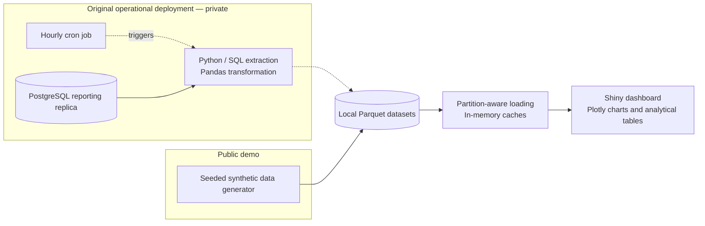

# Order & Taxi Performance Dashboard

A Python analytics application built to improve slow operational reporting by separating database extraction from interactive analysis. The project combines SQL-based data processing, local Parquet storage, cached loading, and a Shiny dashboard for delivery and taxi performance.

**[View the live dashboard on Posit Connect Cloud](https://01a18352-f0ac-9c8f-254e-b299968c8b35.share.connect.posit.cloud/)**

**The public demo uses entirely synthetic data without production database access.** The original extraction scripts and deployment schedule are private; their architecture is described below.


## Problem and results

The original reporting workflow used Zoho Analytics connected to a PostgreSQL reporting replica. Loading dashboards, applying filters, and changing reporting periods repeatedly queried the database, with each action taking approximately 60 seconds.

I implemented an alternative architecture that refreshed analytical datasets hourly and stored them as Parquet files on the application server. Interactive reporting then used those prepared files and in-memory caches.

In the original environment, observed dashboard load times decreased from approximately **60 seconds to 1–2 seconds**, with noticeably faster filtering and date selection. These timings were **informal observations, not controlled benchmarks**.

The architectural trade-off was explicit: reporting reflected the last successful hourly refresh rather than querying live database state for each interaction.

## My contribution

I independently identified the performance problem, initiated the alternative technical solution, and implemented:

- Python and SQL extraction and transformation workflows.
- Incremental delivery updates and historical backfills.
- Local Parquet storage and partition-aware loading.
- Caching, interactive filtering, reporting calculations, and visualizations.
- The Shiny application and subsequent synthetic-data demonstration.

Business requirements, KPI definitions, and the dashboard design were developed collaboratively with company management, building on an initial concept supplied by a director.

## Architecture



## Engineering approach

### Extraction and incremental processing

In the original delivery pipeline, SQL queries extracted records within a rolling lookback window. Python normalized identifiers and timestamps before updating the relevant yearly partitions.

Existing rows matching incoming IDs were replaced with refreshed records, allowing recent changes to be incorporated without rebuilding the entire history. Historical backfills processed requested date ranges in monthly batches through the same transformation and partition-update functions.

Taxi reporting used a separate extraction and ID-based merge into a single Parquet file. Its extraction strategy differed from the rolling-window delivery process.

### Analytical storage and loading

Delivery data is partitioned by year; taxi requests are stored separately. The dashboard selects delivery partitions based on the current and previous reporting periods.

Parquet and PyArrow support selected-column reads, while categorical conversion and numeric downcasting reduce memory overhead. File modification information controls cache reuse, and available dimension values populate interactive filters.

Local storage was selected for low-latency access. Data preparation runs separately from reporting, so user interactions do not require source-database queries.

## Dashboard capabilities

- Current-versus-previous comparisons using presets or custom date ranges.
- Delivery filtering by city, merchant, channel, and account manager.
- Delivery volume, completion, cancellations, revenue, costs, and unit economics.
- Taxi completion, trip value, discounts, distance, duration, and passenger/driver activity.
- Interactive hourly delivery trends and city/merchant breakdowns.

Defaults compare the **latest seven available complete days** with the **preceding seven days**, keeping the dashboard useful even when its dataset is older.


## Demo data

The generator uses a fixed random seed to create approximately two years of hourly delivery aggregates and individual taxi requests. Simulated patterns include weekly demand differences, gradual growth, lunch and dinner peaks, and commute-oriented taxi activity.

Generated files are stored in `demo_data/` and reused across restarts. Generation runs when datasets are missing or the generator version changes. No cron job is required for the public demo.

## Technology stack

| Technology | Purpose |
|---|---|
| Python / Pandas | Processing, transformation, filtering, and aggregation |
| PostgreSQL / SQL / psycopg2 | Original private extraction pipeline |
| Parquet / PyArrow | Columnar storage and selective reads |
| Shiny for Python | Reactive application and reporting controls |
| Plotly | Interactive visualizations |

## Run locally

Use Python 3.12 as a reference environment. From the project directory:

**Windows PowerShell**

```powershell
python -m venv .venv
.\.venv\Scripts\python.exe -m pip install -r requirements.txt
.\.venv\Scripts\python.exe app.py
```

**macOS / Linux**

```bash
python3 -m venv .venv
.venv/bin/python -m pip install -r requirements.txt
.venv/bin/python app.py
```

Open **http://127.0.0.1:8000**. No login is required. The first launch generates the datasets; stop the server with **Ctrl+C**.

For automatic reload:

```powershell
.\.venv\Scripts\python.exe -m shiny run --reload app.py
```

On macOS/Linux, substitute `.venv/bin/python`. To refresh the dataset manually, stop the app, delete the generated `demo_data/` directory, and restart. Keep `APP_MODE` at its default value, `demo`.

## Repository structure

```text
app.py             Dashboard, data loading, caching, and metrics
demo_data.py       Synthetic dataset generation
runtime_mode.py    Demo-mode guards
requirements.txt   Dependencies
assets/            Dashboard screenshots
README.md          Project overview and setup
.gitignore         Local data and private-file exclusions
```
