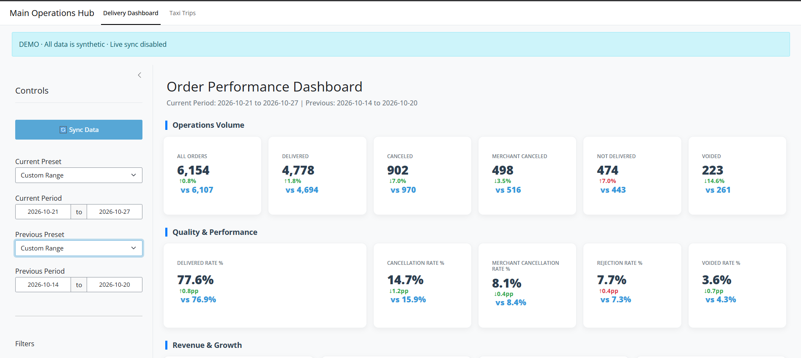
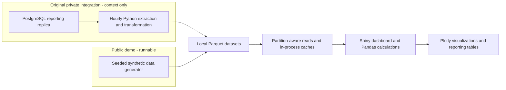
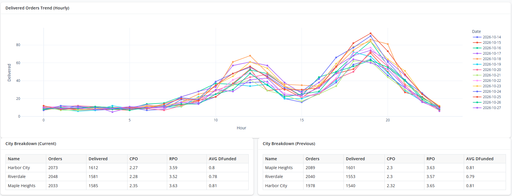

# Order & Taxi Performance Dashboard

An operational analytics application built to solve slow, database-backed reporting at a delivery and taxi platform. The original Zoho Analytics workflow could take around 60 seconds for each reporting action because it queried PostgreSQL repeatedly. I replaced that interaction pattern with a Python dashboard reading locally stored Parquet datasets, refreshed through hourly synchronization in the original deployment.

**The public demo uses entirely synthetic data.** It demonstrates data modeling, file-based analytical serving, caching, and comparative reporting without company records or live database access.

**Live demo:** [Open the dashboard on Posit Connect Cloud](https://01a18352-f0ac-9c8f-254e-b299968c8b35.share.connect.posit.cloud/)


## Engineering highlights

- **Partition-aware loading:** delivery datasets are stored by year; selected comparison periods determine which partitions are loaded.
- **Efficient analytical reads:** PyArrow schema inspection, selected-column reads, categorical conversion, and numeric downcasting limit unnecessary loading and memory use.
- **Cached reporting:** file modification information controls reuse of loaded data and filter choices.
- **Reproducible demo generation:** a fixed random seed creates hourly delivery aggregates and individual taxi requests across approximately two years.
- **Private integration architecture:** rolling-window delivery extraction, ID-based updates, and monthly historical backfills prepare datasets ahead of reporting. These extraction scripts are excluded from the public source set.

## Engineering problem and solution

The previous workflow used Zoho Analytics connected to a PostgreSQL reporting replica. Loading the dashboard, changing dates, or applying filters triggered new database queries, with each reporting action taking approximately 60 seconds in the original environment. This made routine exploration slow: users had to wait again whenever they changed what they wanted to analyze.

I independently identified the performance problem, initiated the alternative technical solution, and implemented its Python processing workflows, Parquet storage, synchronization approach, Shiny application, filtering, calculations, and visualizations. Business requirements, KPI definitions, and the general dashboard design were developed collaboratively with company management, building on an initial dashboard concept supplied by a director.

My solution separated data refresh from user interaction. In the original deployment, synchronization ran once per hour to extract and transform reporting data and update Parquet files stored locally on the application server. The Shiny dashboard read those prepared files and used in-memory caching, so filtering and date changes no longer required a database round trip.

Parquet provides compressed columnar storage and supports reading selected columns. Delivery partitions restrict historical loading to relevant years. Local storage was chosen to prioritize low-latency analytical access. The hourly schedule describes the original deployment; the public demo does not include a scheduler or live synchronization.

In the original environment, observed dashboard load times decreased from roughly 60 seconds to 1–2 seconds, with noticeably faster filtering and date selection. These timings were informal observations rather than controlled benchmarks.

The trade-off is freshness and operational responsibility: reporting reflects the last successful hourly synchronization rather than live database state, so newly changed records may wait until the next refresh. Failed or delayed refreshes can extend that lag. The application also depends on local disk availability, and datasets must be regenerated or synchronized. Local files also require a separate strategy if the application is later deployed across multiple servers.

## Architecture

The original private integration and the runnable public demo feed the same type of analytical serving layer:



In demo mode, startup calls `ensure_demo_data()` before loading the local datasets. It does not call the private PostgreSQL extraction stage. The public dashboard serves synthetic data without a login or live-sync controls. Its entry point refuses production mode; runtime guards also prevent the private integration scripts from running in demo mode.

## Data pipeline design

### Original private extraction and updates

The following describes the integration implementation reviewed locally; its SQL, connection configuration, and scripts are excluded from the public demo.

**Delivery:** a rolling lookback query refreshes recent reporting records. Incoming IDs are converted to strings. For each affected year, existing rows matching incoming IDs are removed and refreshed rows are appended. This update-and-insert approach rewrites affected partitions rather than rebuilding the full history. It assumes appropriate source identifiers; it does not establish exactly-once processing or handle source deletions automatically.

**Historical backfills:** a requested date range is divided into monthly extraction batches. Each batch passes through the same preparation and yearly partition-update functions. Changes older than the lookback window require a backfill.

**Taxi:** a separate ID-based merge maintains one Parquet file. Unlike delivery extraction, the reviewed taxi query has no active date predicate and should not be described as a working incremental-window extract.

The private delivery writer uses Snappy compression and temporary files followed by file replacement. Partition and metadata writes are separate operations, without a transaction spanning all files.

### Transformation and serving in the public demo

- Delivery timestamps and taxi creation times are parsed into datetime columns; normalized date fields support whole-day comparisons while preserving hours for charts.
- The private preparation layer standardizes source identifiers; the demo generator creates fictional string trip, user, and driver IDs directly.
- Repeated dimension values are converted to categorical columns, and eligible numeric columns are downcast.
- Delivery data is stored in `orders_by_year/orders_<year>.parquet`; taxi data is stored separately in `trips.parquet`, both beneath `demo_data/`.
- Delivery loading selects years from the current and previous date ranges and reads required available columns. Taxi data is loaded as a separate cached dataset.
- Delivery partition signatures use file timestamps and sizes; loaded yearly frames and taxi data use modification-time checks for cache reuse.
- Filter choices can be loaded from metadata. When metadata is absent, as in freshly generated demo data, choices and latest dates are derived from selected columns in the partitions and cached in memory.

Interactive sessions calculate metrics from these prepared files rather than issuing live source-database queries.

## Data model and metrics

| Dataset | Synthetic grain | Dimensions and analysis |
|---|---|---|
| Delivery | One hourly aggregate per merchant and city | Channel and account-manager attributes; volume, quality, revenue, and costs |
| Taxi | One trip request | City, status, passenger, driver, price, distance, duration, and discounts |

Delivery outcomes follow this reconciliation rule:

```text
total orders = delivered + canceled + not delivered
```

Merchant cancellations and voids are subsets of canceled orders in the synthetic model. Adding them again would double-count outcomes.

| Metric group | Current application behavior |
|---|---|
| Delivery quality | Delivered, canceled, merchant-canceled, not-delivered, and voided counts; corresponding rates use total orders as denominator |
| Delivery value | GMV sums total order amounts; NMV sums delivered paid amounts |
| Revenue and cost | Service commission, delivery fees, funded discounts, and driver earnings are aggregated separately |
| Unit economics | CPO divides driver earnings by delivered plus not-delivered orders; RPO uses service commission over the same denominator |
| L1 and L2 | Application-defined financial indicators; their labels should not be interpreted as standardized accounting definitions |
| Taxi | Completed, canceled, and timed-out requests; trip value, commission, discounts, average distance/duration, unique passengers/drivers, and trips per passenger/driver |

**Average definitions:** delivery AOV is total order amount divided by total orders. Average funded discount is total funded discount divided by delivered plus not-delivered orders, consistently in the KPI and city/merchant tables. Rows containing cancellations remain included: they can also contain delivered orders. Average delivery distance is total delivery distance divided by delivered orders. Zero-count denominators return zero. Taxi discount averages use successful trip-level records, where each row represents one request.

## Dashboard capabilities

- Default to the latest seven available complete days versus the preceding seven days, separately for delivery and taxi data. Other presets are anchored to each dataset's latest complete day.
- Compare independently selected current and previous periods using presets or custom date ranges. Each tab displays “Synthetic data through: [date]”.
- Filter delivery reporting by city, merchant, channel (labeled “Vertical” in the UI), and account manager; filter taxi reporting by city.
- Inspect delivery and taxi KPI comparisons, including whether higher or lower values are favorable for each indicator.
- Explore hourly delivered-order trends with interactive Plotly charts.
- Compare city and merchant performance in current- and previous-period tables.



*Hourly delivery trends and city comparisons using synthetic data.*

## Synthetic demo dataset

`demo_data.py` generates 731 calendar days of fictional records using `random.Random(42)`: approximately 210,000 hourly delivery aggregates and 64,000 taxi requests. Coverage ends on the day before generation, so the final day has a complete 24-hour profile. The seed makes generation repeatable for the same code version and date; calendar labels move as the generation date changes.

Simulated patterns include weekly demand differences, gradual growth, a smooth periodic demand variation, lunch and dinner delivery peaks, and commute-oriented taxi activity. The periodic variation is illustrative rather than a calibrated annual seasonality model. Merchant-specific cancellation and unsuccessful-delivery probabilities create variation across segments. Taxi timestamps include hours, minutes, and seconds.

Files are generated in the ignored `demo_data/` directory. Existing generated files are reused across restarts and calendar-date changes. Generation runs when files are absent or the generator version changes; no scheduled job is required. To refresh intentionally, stop the app, remove `demo_data/`, and restart. A hosting restart that discards local files also causes regeneration. Monetary values are fictional demo amounts without a declared currency or conversion from company records.

These records illustrate application behavior and metric relationships; they do not represent real business results.

## Technology stack

| Technology | Purpose |
|---|---|
| Python | Processing, dataset generation, and application logic |
| Pandas | Transformation, filtering, aggregation, and metric calculations |
| Parquet / PyArrow | Columnar storage, schema inspection, and selected-column reads |
| Shiny for Python | Reactive dashboard and input controls |
| Plotly | Interactive hourly visualizations |
| PostgreSQL / SQL / psycopg2 | Original private extraction integration; not required as a running service for the demo |

The original PostgreSQL and credential integrations remain private and are not included in the demo dependencies.

## Run locally

Python 3.12 is the reference version for these instructions. Commands match the application entry point; a clean installation and browser session have not been independently verified for this README revision. `APP_MODE` defaults to `demo`; keep that mode for this public demonstration.

### Windows PowerShell

From the project directory:

```powershell
python -m venv .venv
.\.venv\Scripts\python.exe -m pip install -r requirements.txt
.\.venv\Scripts\python.exe app.py
```

### macOS / Linux

```bash
python3 -m venv .venv
.venv/bin/python -m pip install -r requirements.txt
.venv/bin/python app.py
```

Open **http://127.0.0.1:8000**. The direct-run entry point also attempts to open a browser. The dashboard opens directly; no login or credentials are required.

The first launch generates the datasets. Stop the server with **Ctrl+C**. For automatic code reload on Windows:

```powershell
.\.venv\Scripts\python.exe -m shiny run --reload app.py
```

On macOS/Linux, substitute `.venv/bin/python`. To regenerate manually, stop the application, delete only its generated `demo_data/` directory, and restart. VS Code's Run Python File action uses the same direct-run entry point; select the interpreter containing the installed dependencies.

## Public source structure

```text
app.py             Shiny application, loading, caching, filters, and metrics
demo_data.py       Reproducible synthetic data generator
runtime_mode.py    Demo default and live-integration guards
requirements.txt   Python dependencies
assets/            Dashboard preview and hourly-trend screenshots
README.md          Project background, design, and setup
.gitignore         Excludes generated files and private integrations
```

Private integration scripts remain in the local working directory but are explicitly ignored. They are not part of the intended public source tree and are not needed to run the demo. Dashboard screenshots are included in `assets/`.

## Original authentication layer

The original dashboard used HTTP Basic authentication (username and password), with an HMAC-signed cookie for subsequent requests and user-specific city access restrictions. This layer has been removed from the public demo to keep the focus on data processing and analytics. The demo contains no login, credential loading, or user-permission logic.

## Scope, limitations, and possible next steps

The public implementation includes dataset generation, local analytical storage, cached loading, filtering, calculations, tables, and visualizations. It excludes working source-database extraction, company SQL, connection settings, credentials, and real records. It is a portfolio demonstration rather than a validated financial reporting system.

Storage is local and writable; datasets must fit the available disk and memory. Regeneration builds datasets in memory and writes multiple files without a cross-file transaction. Dependencies are currently unpinned. The demo does not establish performance guarantees, distributed storage behavior, or production access-control assurances.

Potential future work, **not implemented as part of this demo**, includes automated reconciliation and metric tests, reproducible dependency locking, CI, containerized deployment, and pipeline freshness/error monitoring.

**Publication review:** this project originated in an employment context. Synthetic data and excluded integrations do not establish permission to publish the remaining source. Employer rights, confidentiality obligations, and any applicable notices require review before public release.


